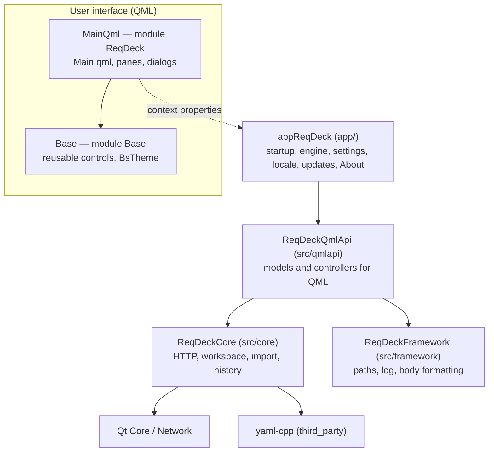
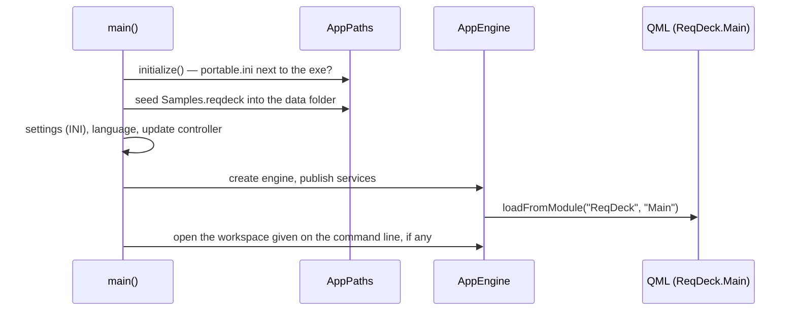
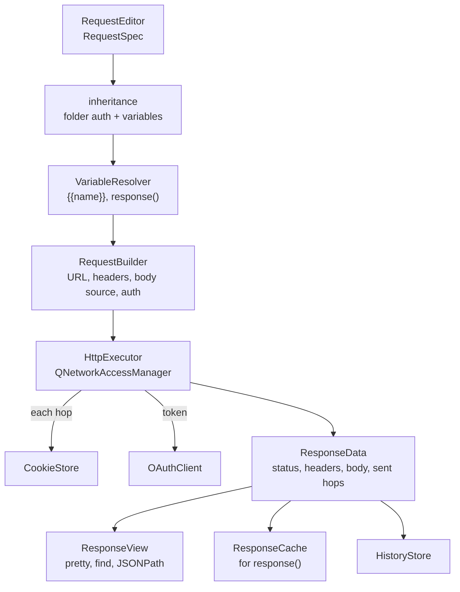

# Architecture

ReqDeck is a native desktop application. It has a Qt Quick (QML) user interface and a C++
core on top of Qt Network.

| | |
|---|---|
| Framework | Qt 6.11: Core, Gui, Network, Qml, Quick, QuickControls2, QuickDialogs2, Svg, LinguistTools |
| Language | C++20 for the logic, QML for the user interface |
| Build | CMake 3.21+, target-based, presets for MSVC 2022 |
| Platform | Windows x86_64 |
| HTTPS | Qt Network with the TLS backend plugins deployed with Qt (Windows Schannel); OpenSSL is not bundled |
| Third-party code | Qt (LGPL-3.0), yaml-cpp 0.9.0 (MIT, vendored), Material Symbols icons (Apache 2.0), Qt Installer Framework (GPL-3.0 with the Qt GPL exception) for the installer |

## Layers

The code is split into static libraries with one-way dependencies. Only the top two layers
know about QML.



| Library / target | Folder | Responsibility |
|---|---|---|
| `ReqDeckFramework` | `src/framework` | Portable or installed data locations (`AppPaths`), the in-app log models, body pretty-printing |
| `ReqDeckCore` | `src/core` | Everything without a user interface. **http:** request model, variable resolver, request builder, executor, cookies, OAuth, JSONPath, cURL converter, response cache. **workspace:** data model, serializer, folder inheritance, secret store and DPAPI cipher, backups. **import:** Postman, Insomnia, OpenAPI, YAML-to-JSON. **history:** history store |
| `ReqDeckQmlApi` | `src/qmlapi` | `QObject` models and controllers that QML binds to: workspace manager, collection tree, request editor, response view, environments, history, tabs, cookies, import, help, syntax highlighters |
| `appReqDeck` | `app` | `main()`, the application object and settings, the QML engine that publishes the services, language switching, update check, About and license list |
| `MainQml` | `qml` | Screens and dialogs: launcher, main screen, request and response panes, collection and history panes, environment, cookie, import, settings, and About dialogs |
| `Base` | `qml/Base` | Reusable controls (`Bs*`): key–value table, menu bar, status bar, help panel, command palette, variable completer, theme |

### C++ ↔ QML boundary

`AppEngine` (a `QQmlApplicationEngine`) creates the services and publishes them to QML as
context properties: `cppWorkspaceManager`, `cppCollection`, `cppRequestEditor`,
`cppResponse`, `cppEnvironments`, `cppHistory`, `cppTabs`, `cppCookies`, `cppImport`,
`cppHelp`, `cppLocale`, `cppUpdate`, and others. Their types are registered as
uncreatable, so QML uses them but never creates them.

The `Base` module does not import any C++ module. Its controls stay independent of the
application and are tested on their own.

## Startup



`ReqDeck.exe [workspace.reqdeck]` opens a workspace at start.

## Sending a request



1. The **request editor** holds the request as a `RequestSpec`: method, URL, params,
   headers, body, auth, and timeout.
2. **Inheritance** adds the auth and variables of the folders above it.
3. The **variable resolver** replaces `{{name}}` and `{{response(…)}}`. Missing names stop
   the send, and the *Values needed* dialog asks for them.
4. The **request builder** makes a `QNetworkRequest` and a body source. Files are streamed,
   not loaded.
5. The **executor** sends it asynchronously on the GUI thread and follows redirects itself,
   so that credentials can be dropped across origins. It stores and sends cookies on every
   hop, applies the timeout, and keeps large bodies in a temporary file instead of memory.
6. The **response** goes to the view, to the in-memory cache for `response()`, and,
   without its body, to the history.

### Threading

ReqDeck uses Qt's asynchronous networking on the GUI thread. There are no worker threads:
`QNetworkAccessManager` does its I/O without blocking the event loop, and every request
in a tab has its own executor. Requests in different tabs therefore run at the same time.

## Persistence

- **Workspace:** `WorkspaceSerializer` reads and writes the `.reqdeck` JSON with a schema
  version. Writes are atomic. `WorkspaceBackup` keeps a copy before a schema upgrade.
- **Secrets, cookies, tokens:** separate JSON files per workspace, encrypted by
  `SecretCipher` with Windows DPAPI (`Crypt32`).
- **History:** `HistoryStore`, a JSON file of up to 200 entries without credentials.
- **Settings:** an INI file through `QSettings`.

Details: [Workspaces and Data](Workspaces-and-Data).

## User interface

- Qt Quick Controls with a custom theme (`BsTheme`) in light and dark, with a magenta
  accent.
- A three-pane layout: workspace (collection and history), request, and response, with
  tabs above the request.
- F1 help comes from `resources/help/help.en.json` and `help.ru.json`. `HelpLocator`
  finds the topic of the control under the pointer or in focus.
- The interface text is in English and prepared for translation with Qt Linguist
  (`translations/`). The help and the guide are in English and Russian.

## Repository layout

```text
app/            application entry, engine, settings, locale, updates
src/framework/  ReqDeckFramework
src/core/       ReqDeckCore: http/, workspace/, import/, history/
src/qmlapi/     ReqDeckQmlApi
qml/            MainQml (module ReqDeck) and qml/Base (module Base)
resources/      icons, help texts, guide PDFs, samples workspace
translations/   Qt Linguist files
tests/          unit, qml, screens, support (mock HTTP server), bench
third_party/    yaml-cpp 0.9.0
packaging/      product.json, release.ps1, measure.ps1, guide builder, Pages page
installer/      Qt Installer Framework config, package, wizard styles
.github/        CI and release workflows
cmake/          product metadata and Windows version resource
LICENSES/       full license texts
```

## Product metadata from one place

`packaging/product.json` is the single source of the version, names, and update settings.
CMake reads it (`cmake/ProductMetadata.cmake`) and generates:

- `productinfo.h` for the code;
- the Windows version resource of the executable.

`release.ps1` uses the same file for the installer and the update repository. See
[Release Process](Release-Process).
