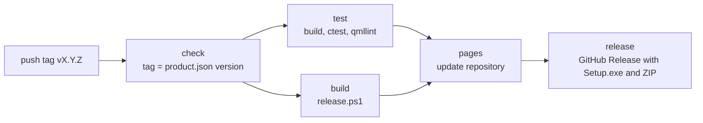

# Release Process

## Versioning

ReqDeck follows [Semantic Versioning](https://semver.org/): `MAJOR.MINOR.PATCH`. The
version is defined in **one place**, the field `version` in `packaging/product.json`.
From there it flows to:

- the *Help → About* dialog;
- the Windows file properties of `ReqDeck.exe`;
- the installer;
- the update repository.

Changes are recorded in [`CHANGELOG.md`](https://github.com/SEB103/ReqDeck/blob/master/CHANGELOG.md)
in the [Keep a Changelog](https://keepachangelog.com/) format.

## What a release contains

`packaging/release.ps1` builds the Release configuration once. It deploys it with
`windeployqt`, checks the deployment (`verify-deployment.ps1`), and produces:

| Output | Description |
|---|---|
| `ReqDeck-<version>-Setup.exe` | a hybrid Qt Installer Framework installer: offline content, with updates from the online repository |
| `ReqDeck-<version>-win64.zip` | the portable package, with `portable.ini` |
| `repository/` | the update repository made by `repogen`, for the Maintenance Tool |

Licenses and notices are part of the deployment; the user manual is compiled into the
application. After the GitHub Release, the job `wiki` publishes the manual and these
developer pages to the GitHub wiki.

## Continuous integration

Two GitHub Actions workflows run on `windows-2022` with Qt 6.11.1 and MSVC:

- **CI** (`.github/workflows/ci.yml`), on every push and pull request:
  1. configure with Ninja, Release, tests on;
  2. build;
  3. `ctest`;
  4. `all_qmllint`.
- **Release** (`.github/workflows/release.yml`), on a tag `vX.Y.Z`:

Nothing is published unless every earlier job succeeds.

The update repository goes to GitHub Pages **before** the GitHub Release is created. So the
repository is online by the time the Releases API reports the new version. A manual run
(*Actions → Release → Run workflow*) is a dry run: it builds and tests, but publishes
nothing.

## Cutting a release

1. Set `"version": "X.Y.Z"` in `packaging/product.json`.
2. Move the `[Unreleased]` entries of `CHANGELOG.md` under `## [X.Y.Z] - YYYY-MM-DD`.
3. Commit, tag the commit `vX.Y.Z`, and push the commit and the tag.
4. Watch *Actions → Release*: all five jobs must be green.
5. Check that the release page lists both files, and that
   `https://seb103.github.io/ReqDeck/updates/stable/Updates.xml` names the new version.

## How users get the update

- **Installed copies:** *Help → Check for Updates* finds the release through the GitHub
  Releases API. *Install update* starts the Maintenance Tool, which installs it from the
  Pages repository.
- **Portable copies:** the same check offers the download page.

## Release history

| Version | Date | Notes |
|---|---|---|
| 1.0.0 | 2026-11-13 | first public release |
