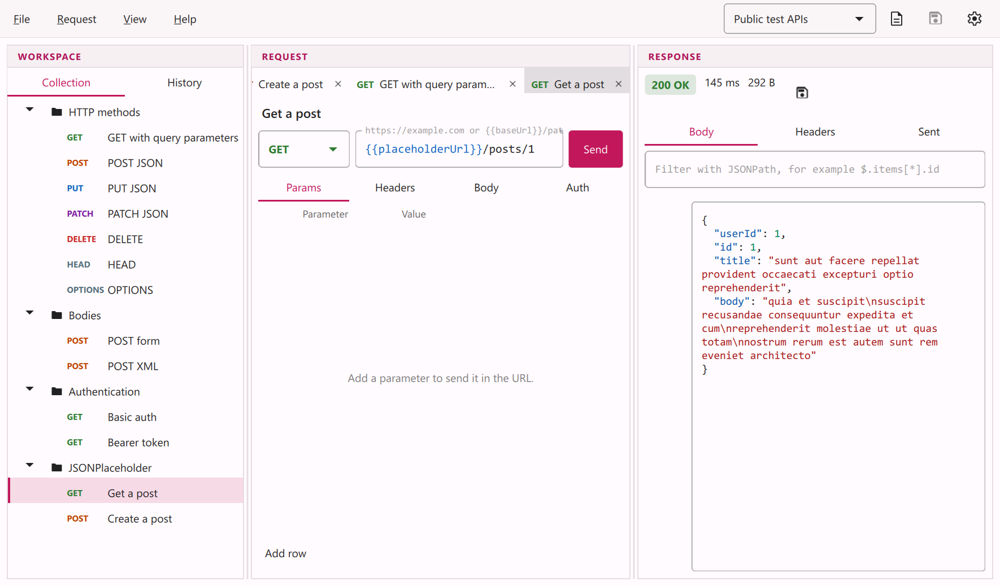
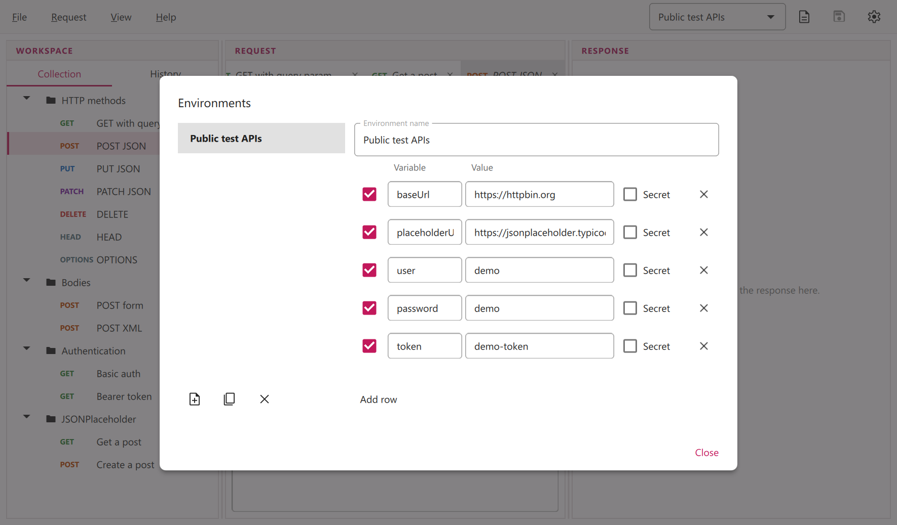

# Erste Schritte

Dieser Rundgang dauert etwa fünf Minuten. Er verwendet den Beispiel-Arbeitsbereich, der
mit ReqDeck kommt; Sie brauchen nur eine Internetverbindung.

## 1. Beispiele öffnen

Starten Sie ReqDeck und drücken Sie auf dem Startbildschirm **Beispiele öffnen**. Die
Anfrage **Create a post** öffnet sich. Sie sendet einen kleinen JSON-Body mit `POST` an
`jsonplaceholder.typicode.com`, eine öffentliche Test-API, die so tut, als würde sie
Blogbeiträge speichern. Daneben im Baum liest **Get a post** einen Beitrag zurück.

Das Fenster hat drei Teile:

- **links:** der Baum der Sammlung mit Ordnern und Anfragen und der Reiter Verlauf;
- **Mitte:** die Anfrage – Methode, URL und die Reiter Params, Header, Body, Auth;
- **rechts:** die Antwort.

## 2. Senden

Drücken Sie **Senden** oder **Strg+Eingabe**. Die Antwort zeigt ein grünes
**201 Created**, die Zeit, die Größe und den Body als formatiertes JSON. Klicken Sie dann
im Baum auf **Get a post** und senden Sie auch diese Anfrage: Die Antwort ist **200 OK**
mit einem Beitrag.

Was Sie in der Antwort ausprobieren können:

- zwischen **Body**, **Header** und **Gesendet** wechseln; *Gesendet* zeigt, was wirklich
  hinausging;
- **Strg+F** drücken und im Body suchen, dann F3 für den nächsten Treffer;
- `$.title` in den **JSONPath-Filter** über dem Body eingeben.

## 3. Etwas ändern

- Ändern Sie in **Get a post** die Zahl am Ende der URL und senden Sie erneut.
- Öffnen Sie **Params** und fügen Sie eine Zeile hinzu; die URL folgt.
- Sehen Sie sich die URLs an: `{{placeholderUrl}}` und `{{baseUrl}}` sind **Variablen**
  aus der Umgebung *Public test APIs*, die oben in der Leiste gewählt ist. Siehe
  [Variablen und Umgebungen](Variables-and-Environments).

## 4. Hilfe zu allem

Zeigen Sie auf ein Feld oder eine Schaltfläche und drücken Sie **F1**. Eine kurze
Erklärung erscheint, in der Sprache der Oberfläche. **Mehr im Handbuch** darunter öffnet
den passenden Abschnitt dieses Handbuchs, und *Hilfe → Benutzerhandbuch* öffnet das
Handbuch am Anfang.

## 5. Einen eigenen Arbeitsbereich anlegen

1. *Datei → Neuer Arbeitsbereich…*, wählen Sie einen Namen und einen Ort für die Datei
   `.reqdeck`.
2. *Anfrage → Neue Anfrage* (**Strg+N**), oder legen Sie zuerst einen Ordner im Baum an.
3. Geben Sie eine URL ein, senden Sie und speichern Sie mit **Strg+S**. Ein `*` im
   Fenstertitel bedeutet ungespeicherte Änderungen.

Haben Sie schon Anfragen in einem anderen Werkzeug? Nutzen Sie *Datei → Sammlung
importieren…* oder fügen Sie einen cURL-Befehl ein: siehe
[Import und Export](Import-and-Export).
