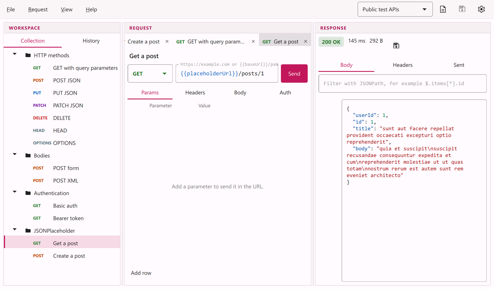

# ReqDeck-Benutzerhandbuch

**ReqDeck** ist ein kostenloser Desktop-Client für Windows, mit dem Sie HTTP- und
REST-Anfragen erstellen, senden und speichern. Ihre Arbeit liegt in einer Datei auf
Ihrem Computer, Sie brauchen kein Konto, und jedes Element erklärt sich selbst: zeigen
Sie darauf und drücken Sie **F1**.

## Wofür es da ist

Wer mit Web-APIs arbeitet, sendet eine Anfrage, sieht sich die Antwort an, ändert einen
Wert und sendet erneut, viele Male am Tag. Genau dafür ist ReqDeck gemacht:

- einen Endpunkt ausprobieren, während Sie einen Server schreiben oder Fehler suchen;
- die Anfragen eines Projekts aufbewahren, mit Umgebungen wie *lokal*, *Staging* und
  *Produktion*;
- sich mit OAuth 2.0 oder einem API-Schlüssel anmelden und ein Token aus einer Antwort
  in die nächste Anfrage übernehmen;
- Sammlungen aus Postman, Insomnia oder einem OpenAPI-Dokument übernehmen;
- genau sehen, was gesendet wurde, Weiterleitungen eingeschlossen.

## Versprechen

- **Kein Konto.** Jede Funktion arbeitet ohne Anmeldung irgendwo.
- **Ihre Daten sind eine sichtbare Datei** (`.reqdeck`, JSON) dort, wo Sie sie ablegen.
- **Keine Telemetrie.** ReqDeck verbindet sich nur mit den Servern, die Ihre Anfragen und
  Anmeldungen nennen, und mit GitHub, wenn Sie nach Updates suchen.
- **Geheime Werte bleiben außerhalb der Arbeitsbereichsdatei**, verschlüsselt für Ihr
  Windows-Benutzerkonto.
- **Es zeigt, was es wirklich gesendet hat**, mit verdeckten Zugangsdaten.
- **Keine Werbung, keine Banner, keine Bereiche, die sich nicht schließen lassen.**

## In diesem Handbuch

| Seite | Inhalt |
|---|---|
| [Installation](Installation) | Installer, portable Version, Speicherorte, Updates |
| [Erste Schritte](Getting-Started) | Ihre erste Anfrage in fünf Minuten |
| [Anfragen](Requests) | Methoden, Parameter, Header, Body, Dateien, Reiter, Cookies |
| [Antworten](Responses) | Status, Body, Suche, JSONPath-Filter, Reiter Gesendet, Speichern, Verlauf |
| [Variablen und Umgebungen](Variables-and-Environments) | `{{Variablen}}`, geheime Werte, Ordner, Verkettung mit `response()` |
| [Authentifizierung](Authentication) | Basic, Bearer, API-Schlüssel, OAuth 2.0 |
| [Arbeitsbereiche und Daten](Workspaces-and-Data) | Die Arbeitsbereichsdatei und was daneben liegt |
| [Import und Export](Import-and-Export) | cURL, Postman, Insomnia, OpenAPI |
| [Tastenkürzel](Keyboard-Shortcuts) | Alle Tastenkürzel |
| [Sicherheit und Datenschutz](Security-and-Privacy) | Was Ihren Computer verlässt und wie geheime Werte geschützt sind |
| [Fehlerbehebung und FAQ](Troubleshooting-and-FAQ) | Wenn etwas nicht funktioniert, und bekannte Grenzen |

## Die Oberfläche und ihre Sprache

Das Fenster hat drei Teile: links den Arbeitsbereich (Sammlung und Verlauf), in der Mitte
die Anfrage und rechts die Antwort. **EN** oder **DE** oben rechts schaltet die
Oberfläche zwischen Englisch und Deutsch um; dieses Handbuch und die F1-Hilfe folgen ihr.
