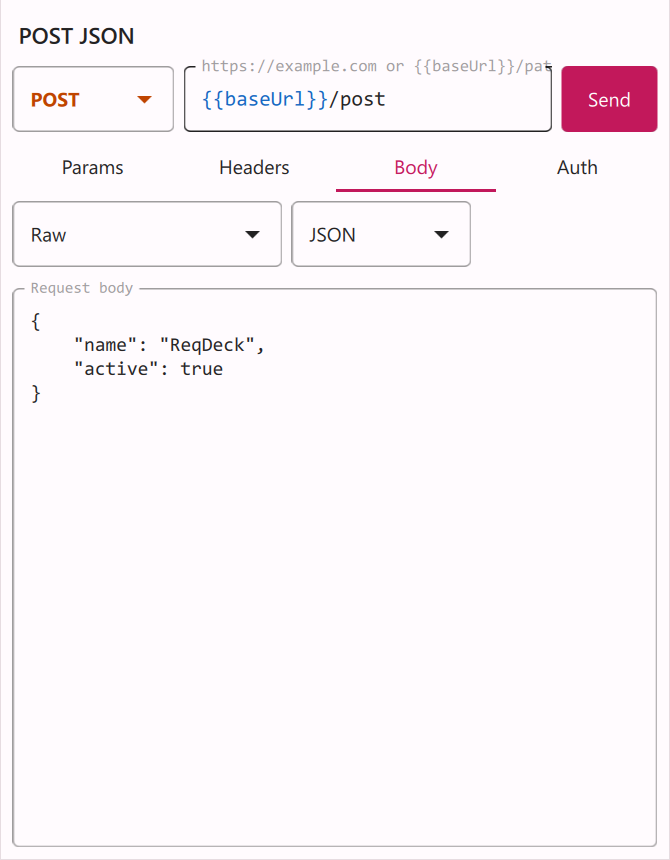

# Anfragen

Stellen Sie sich eine Anfrage wie einen Brief vor. Die Methode sagt, was Sie wollen, die
Adresse, wohin er geht, Parameter und Header sind Vermerke auf dem Umschlag, und der Body
ist der Brief darin.

## Methode und Adresse

| Methode | Wofür |
|---|---|
| GET | Etwas lesen. Ohne Body. |
| POST | Etwas Neues anlegen. Meist mit Body. |
| PUT / PATCH | Etwas Bestehendes ändern. |
| DELETE | Etwas entfernen. |

ReqDeck bietet jede Methode an. Die Adresse darf `{{Variablen}}` enthalten, siehe
[Variablen und Umgebungen](Variables-and-Environments).

## Parameter und Header

Parameter werden nach einem Fragezeichen an die Adresse gehängt, zum Beispiel `?page=2`.
Bearbeiten Sie sie in der Tabelle **Params**; die Adresse folgt. Header tragen
Informationen über die Anfrage, etwa das Format, das Sie annehmen, und werden unter
**Header** bearbeitet. Mehrfache Header-Namen sind erlaubt.

## Body

| Body | Was gesendet wird |
|---|---|
| Kein Body | Nichts |
| Raw | Text als JSON, XML oder einfacher Text |
| URL-kodiertes Formular | Felder als `name=wert&…`, wie ein einfaches Webformular sie sendet |
| Formulardaten | Textfelder und Dateien, wie ein Webformular mit Upload sie sendet |
| Datei | Eine Datei als Body, Byte für Byte, mit einem Content-Type nach ihrem Namen |

Dateien werden von der Festplatte gestreamt, auch große Uploads funktionieren. Eine
Datei, die Sie mit **Durchsuchen…** gewählt haben, wird ohne Rückfrage gesendet; bei
jedem anderen Pfad fragt ReqDeck einmal, bevor es diese Datei an diesen Server hochlädt,
siehe [Sicherheit und Datenschutz](Security-and-Privacy#datei-uploads).

## Timeout, Weiterleitungen, Proxy

- Jede Anfrage hat ein Timeout für die Übertragung, 30 Sekunden, wenn Sie kein anderes
  einstellen.
- **Senden** wird zu **Abbrechen**, solange eine Anfrage läuft.
- Weiterleitungen verfolgt ReqDeck selbst, nie von `https` zu `http`; Zugangsdaten
  entfallen, wenn eine Weiterleitung den ursprünglichen Server verlässt.
- Anfragen nutzen den in Windows eingestellten Proxy, außer Anfragen an diesen Computer.

## Sammlung und Ordner

Der Baum links enthält Ordner und Anfragen. Legen Sie sie an, benennen Sie sie um,
duplizieren und löschen Sie sie; Strg+Klick oder Umschalt+Klick wählt mehrere Elemente,
**F2** benennt um, **Entf** löscht, und Rechtsklick → *A–Z sortieren* ordnet einen Ordner.
**Strg+K** findet jede Anfrage über ein paar Wörter ihres Namens oder ihrer Adresse und
jeden Menübefehl.

Ordner geben ihre **Autorisierung** und **Variablen** an die Anfragen darin weiter; siehe
[Authentifizierung](Authentication#vererbung-von-ordnern).

## Reiter

Anfragen öffnen sich in Reitern über der Anfrage. Ein Klick im Baum zeigt eine Anfrage im
Vorschau-Reiter, dessen Name kursiv ist; der nächste Klick ersetzt ihn. Ein Doppelklick,
eine Änderung oder ein Senden behält den Reiter.

> [!TIP]
> Jeder Reiter behält die Antwort seines letzten Sendens, und eine langsame Anfrage in
> einem Reiter hält die anderen nicht auf.

**Strg+Tab** wechselt die Reiter, **Strg+W** schließt einen. *Einstellungen → Reiter
anzeigen, um mehrere Anfragen offen zu halten* schaltet die Reiter ab, wenn Sie lieber
eine Anfrage nach der anderen bearbeiten.

## Cookies

Viele Dienste melden Sie einmal an und erkennen Sie dann an einem Cookie. ReqDeck
behält die Cookies, die ein Server setzt, und sendet sie mit den nächsten Anfragen an
diesen Server zurück, Weiterleitungen eingeschlossen; so funktionieren die Anfragen nach
einer Anmeldung:

1. Senden Sie die Anmeldeanfrage, zum Beispiel `POST {{baseUrl}}/login` mit Benutzername
   und Passwort.
2. Senden Sie die nächste Anfrage. Ihr Cookie-Header trägt die Sitzung der Anmeldung.
3. Wählen Sie *Anfrage → Cookies…*, um die Cookies dieses Arbeitsbereichs zu sehen, einen
   Wert zu ändern oder sie zu löschen. Der Dialog kann Cookies für den Arbeitsbereich
   auch abschalten.

> [!NOTE]
> Ein in einer Anfrage eingegebener Cookie-Header hat Vorrang: ReqDeck sendet dann nur
> diesen und sagt das über der Antwort.

Dauerhafte Cookies werden neben dem Arbeitsbereich gespeichert, verschlüsselt für Ihren
Windows-Benutzer; Sitzungs-Cookies werden nie auf die Festplatte geschrieben.
