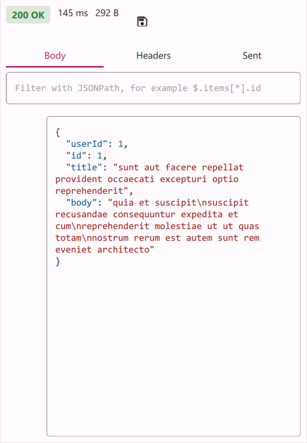
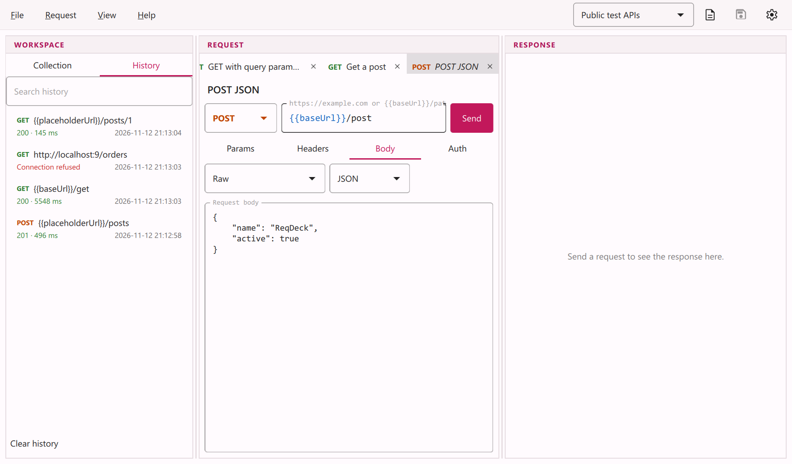

# Antworten

## Status

Die erste Zahl sagt, ob die Anfrage funktioniert hat. Codes mit 2 am Anfang bedeuten
Erfolg, mit 4 ein Problem mit der Anfrage, mit 5 ein Problem auf dem Server.

| Status | Bedeutung |
|---|---|
| 200 OK | Es hat funktioniert. |
| 201 Created | Etwas Neues wurde angelegt. |
| 204 No Content | Es hat funktioniert; es gibt nichts zu zeigen. |
| 400 Bad Request | Der Server hat die Anfrage nicht verstanden. Prüfen Sie Body und Parameter. |
| 401 Unauthorized | Sie sind nicht angemeldet, oder das Token ist abgelaufen. |
| 403 Forbidden | Sie sind angemeldet, dürfen das aber nicht. |
| 404 Not Found | Unter dieser Adresse gibt es nichts. Prüfen Sie die URL. |
| 429 Too Many Requests | Langsamer, und später noch einmal versuchen. |
| 500 Internal Server Error | Der Server ist gescheitert. Meist nicht Ihr Fehler. |

Neben dem Status zeigt ReqDeck die Zeit und die Größe der Antwort.

## Body und Header

- **Body** zeigt die Antwort; **Formatiert** stellt JSON und XML mit Hervorhebung und
  Zeilennummern dar, ausgeschaltet sehen Sie den Text, wie er ankam.
- **Header** listet die Header der Antwort.
- Sehr große Antworten werden auf der Festplatte statt im Speicher gehalten, und nur ihr
  Anfang wird angezeigt.

## Text suchen

**Strg+F** sucht Text in der Antwort und zählt die Treffer; **F3** und **Umschalt+F3**
springen zwischen ihnen.

## JSONPath-Filter

Eine lange JSON-Antwort? Geben Sie im Feld darüber einen JSONPath ein, zum Beispiel
`$.items[*].id`, und nur diese Werte werden angezeigt. Ein ungültiger Pfad wird unter dem
Feld erklärt. Leeren Sie das Feld, um wieder alles zu sehen. Es wird kein Skript
ausgeführt.

## Reiter Gesendet

Der Reiter **Gesendet** zeigt, was wirklich an den Server ging: Methode, Adresse, Header
und die Größe des Body, ein Block für jede Weiterleitung. Passwörter, Token, Cookie-Werte
und API-Schlüssel sind verdeckt, zum Beispiel `Bearer ••••••`. Die Netzwerkschicht fügt
ein paar eigene Header hinzu, etwa `Host` und `Accept-Encoding`, die nicht aufgeführt
sind.

## Antwort speichern

Die Schaltfläche zum Speichern neben der Größe schreibt die Antwort so in eine Datei, wie
sie ankam, entpackt, wenn sie komprimiert kam – auch eine sehr große, von der nur der
Anfang angezeigt wird.

## Zertifikate

Wenn dem Zertifikat eines Servers nicht vertraut wird, wie bei Testservern üblich, hält
die Anfrage mit einem Hinweis an. Bei einem Server, den Sie kennen, drücken Sie
**Fortfahren**: Die Anfrage wird noch einmal ohne Prüfung gesendet, für diesen Server und
die Fehler, die er zeigte. Die Antwort trägt dann eine Warnung.

## Verlauf

Jede gesendete Anfrage landet links im **Verlauf**. Ein Doppelklick auf einen Eintrag
macht daraus eine neue Anfrage. Das Suchfeld darüber behält die Einträge, die jedes
eingegebene Wort enthalten, zum Beispiel `post orders`.

Der Verlauf behält die letzten 200 Anfragen ohne ihre Antworten. Werte von Feldern, deren
Namen Zugangsdaten kennzeichnen, werden vor dem Speichern entfernt; siehe
[Arbeitsbereiche und Daten](Workspaces-and-Data#verlauf).
