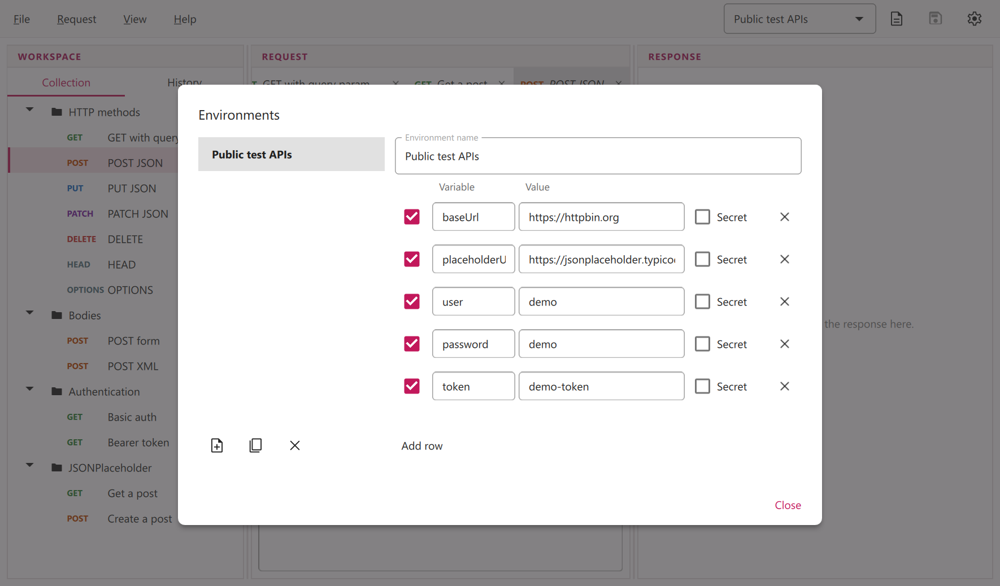

# Variablen und Umgebungen

## Variablen

Schreiben Sie `{{name}}` überall dort, wo ein Wert hingehört:

- in die URL;
- in die Tabellen Params, Header und Formular;
- in die Felder der Authentifizierung;
- in den Body.

ReqDeck ersetzt sie kurz vor dem Senden durch den Wert. Die Ersetzung ist reiner Text;
nichts wird ausgewertet.

- Nach `{{` erscheint eine Liste bekannter Namen. **Eingabe** oder **Tab** fügt den
  gewählten ein. Im Body betrachtet die Liste nur die aktuelle Zeile.
- Ein Name ohne Wert ist **rot unterstrichen**, und ein Feld, das eine unbekannte Variable
  nennt, bekommt einen roten Rahmen.
- Beim **Senden** fragt ReqDeck im Dialog *Werte benötigt* nach jedem fehlenden Wert. Ein
  dort eingegebener Wert gilt **einmal**; mit dem Häkchen zum Behalten wird er als geheime
  Variable gespeichert.

## Umgebungen

Eine Umgebung ist eine benannte Gruppe von Variablen, zum Beispiel *Lokal*, *Staging*
und *Produktion*, jede mit eigener `baseUrl` und eigenem `token`. Die Auswahl oben in der
Leiste bestimmt die aktive; der Umgebungseditor legt sie an, benennt sie um und füllt sie.



### Geheime Variablen

Markieren Sie eine Variable als **Geheim** für Passwörter, Token und Schlüssel:

- ihr Wert ist im Editor verdeckt;
- sie wird **nicht in die Datei `.reqdeck` geschrieben**; sie liegt getrennt davon,
  verschlüsselt für Ihr Windows-Benutzerkonto (siehe
  [Arbeitsbereiche und Daten](Workspaces-and-Data));
- auf einem anderen Computer wird der Wert erneut abgefragt.

Wenn Sie ein Passwort oder Token direkt in ein Feld der Authentifizierung eingeben, zeigt
ReqDeck einen Hinweis mit **In einen geheimen Wert verschieben**. Ein Klick legt eine
geheime Variable an und setzt `{{name}}` in das Feld.

## Ordnervariablen und Reihenfolge

Auch ein Ordner kann Variablen haben. Eine Anfrage sieht die Variablen aller Ordner über
ihr. Ist derselbe Name an mehreren Stellen festgelegt, gewinnt die spätere Quelle in
dieser Liste:

1. Ordner, vom äußersten zum innersten;
2. die aktive Umgebung;
3. Werte, die im Dialog *Werte benötigt* für dieses Senden eingegeben wurden.

## Anfragen verketten mit `response()`

Ein Wert aus der **letzten Antwort** einer anderen Anfrage lässt sich in diese einsetzen:

```text
{{response("Login", "$.token")}}
{{response("Login", "header:Location")}}
```

- Das erste Argument ist der Name (oder die ID) der anderen Anfrage.
- Das zweite ist ein JSONPath in deren JSON-Body, etwa `$.token` oder `$.items[0].id`,
  oder `header:Name` für einen Header der Antwort.

Typischer Ablauf:

1. Senden Sie *Login* einmal.
2. Setzen Sie in *Get profile* den Header `Authorization` auf
   `Bearer {{response("Login", "$.token")}}`.
3. Senden Sie *Get profile*; das Token aus der letzten Antwort von *Login* wird eingesetzt.

Gut zu wissen:

- Nach `{{res` bietet die Vervollständigung `response("Name", "$")` für jede Anfrage an,
  die eine Antwort hat.
- Die Antworten werden **nur im Speicher** gehalten und nie auf die Festplatte
  geschrieben. Senden Sie nach einem Neustart die erste Anfrage erneut.
- Teilen sich mehrere Anfragen einen Namen, gilt die, deren Antwort zuletzt kam.
- Vorlagen werden beim Umbenennen einer Anfrage nicht angepasst: Verwenden Sie danach den
  neuen Namen.
- Dafür werden JSON-Bodys bis 4 MB behalten.
