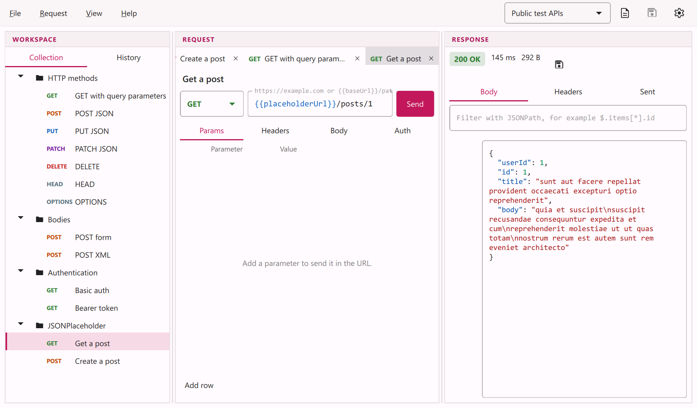
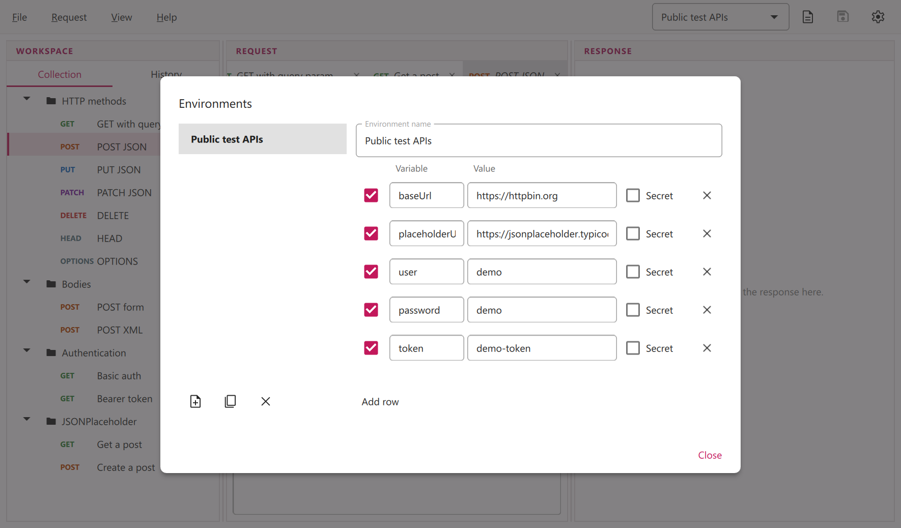

# Getting Started

This walkthrough takes about five minutes. It uses the samples workspace that comes with
ReqDeck, so you need nothing but an internet connection.

## 1. Open the samples

Start ReqDeck and press **Open Samples** in the launcher. The request **Create a post**
opens. It sends a small JSON body with `POST` to `jsonplaceholder.typicode.com`, a public
test API that pretends to store blog posts. Next to it in the tree, **Get a post** reads
one post back.

The window has three parts:

- **left:** the collection tree with folders and requests, and the History tab;
- **middle:** the request — method, URL, and the tabs Params, Headers, Body, Auth;
- **right:** the response.

## 2. Send it

Press **Send** or **Ctrl+Enter**. The response shows a green **201 Created**, the time,
the size, and the body as formatted JSON. Then click **Get a post** in the tree and send
it too: the answer is **200 OK** with one post.

Things to try in the response:

- switch between **Body**, **Headers**, and **Sent**; *Sent* shows what really went out;
- press **Ctrl+F** and search the body, then F3 for the next match;
- type `$.title` into the **JSONPath filter** above the body.

## 3. Change something

- In **Get a post**, change the number at the end of the URL and send again.
- Open **Params** and add a row; the URL follows.
- Look at the URLs: `{{placeholderUrl}}` and `{{baseUrl}}` are **variables** from the
  environment *Public test APIs*, chosen in the top bar. See
  [Variables and Environments](Variables-and-Environments).

## 4. Ask for help on anything

Point at any field or button and press **F1**. A short explanation appears, in the
language of the interface. **More** below it opens the matching section of this manual,
and *Help → User Manual* opens the manual at its start.

## 5. Make your own workspace

1. *File → New Workspace…*, choose a name and a place for the `.reqdeck` file.
2. *Request → New Request* (**Ctrl+N**), or add a folder first in the tree.
3. Enter a URL, send, and save with **Ctrl+S**. A `*` in the window title means unsaved
   changes.

Already have requests elsewhere? Use *File → Import Collection…* or paste a cURL command:
see [Import and Export](Import-and-Export).
