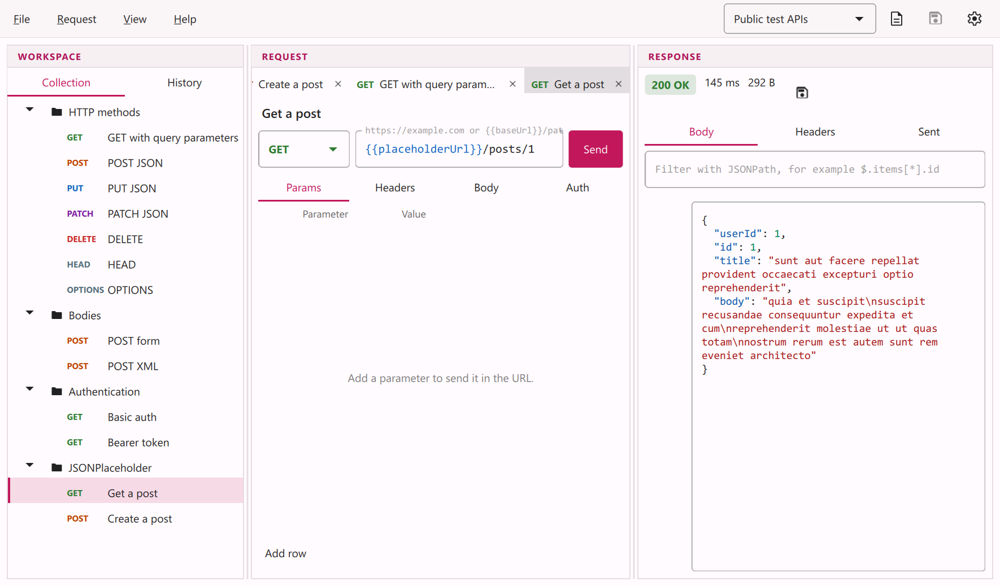

# ReqDeck User Manual

**ReqDeck** is a free desktop client for Windows to compose, send, and save HTTP and REST
requests. It keeps your work in one file on your computer, needs no account, and explains
every part of itself: point at anything and press **F1**.

## What it is for

Developers and testers who work with web APIs send a request, look at the answer, change
one value, and send it again, many times a day. ReqDeck is made for exactly that:

- try an endpoint while writing or debugging a server;
- keep the requests a project needs, with environments such as *local*, *staging*, and
  *production*;
- log in with OAuth 2.0 or an API key and pass a token from one answer into the next
  request;
- bring over collections from Postman, Insomnia, or an OpenAPI document;
- see exactly what went over the wire, redirects included.

## Promises

- **No account.** Every function works without signing in anywhere.
- **Your data is one visible file** (`.reqdeck`, JSON) where you put it.
- **No telemetry.** ReqDeck connects only to the servers your requests and logins name,
  and to GitHub when you check for updates.
- **Secrets stay out of the workspace file**, encrypted for your Windows user account.
- **It shows what it really sent**, with credentials masked.
- **No ads, no banners, no panels you cannot close.**

## In this manual

| Page | What it covers |
|---|---|
| [Installation](Installation) | Installer, portable version, where data is stored, updates |
| [Getting Started](Getting-Started) | Your first request in five minutes |
| [Requests](Requests) | Methods, parameters, headers, bodies, files, tabs, cookies |
| [Responses](Responses) | Status, body, search, JSONPath filter, Sent tab, saving, history |
| [Variables and Environments](Variables-and-Environments) | `{{variables}}`, secrets, folders, chaining with `response()` |
| [Authentication](Authentication) | Basic, Bearer, API key, OAuth 2.0 |
| [Workspaces and Data](Workspaces-and-Data) | The workspace file and what is kept beside it |
| [Import and Export](Import-and-Export) | cURL, Postman, Insomnia, OpenAPI |
| [Keyboard Shortcuts](Keyboard-Shortcuts) | Every shortcut |
| [Security and Privacy](Security-and-Privacy) | What leaves your computer, and how secrets are kept |
| [Troubleshooting and FAQ](Troubleshooting-and-FAQ) | When something does not work, and known limits |

## The interface and its language

The window has three parts: the workspace on the left (collection and history), the
request in the middle, and the response on the right. **EN** or **DE** at the top right
switches the interface between English and German; this manual and the F1 help follow it.
