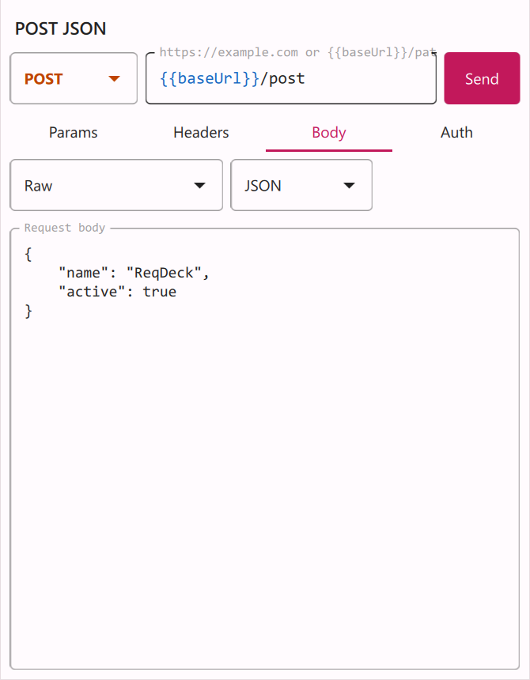

# Requests

Think of a request as a letter. The method is what you ask for, the address is where it
goes, parameters and headers are notes on the envelope, and the body is the letter inside.

## Method and address

| Method | Use |
|---|---|
| GET | Read something. No body. |
| POST | Create something new. Usually with a body. |
| PUT / PATCH | Change something that exists. |
| DELETE | Remove something. |

ReqDeck offers every method. The address may contain `{{variables}}`, see
[Variables and Environments](Variables-and-Environments).

## Parameters and headers

Parameters are added to the address after a question mark, for example `?page=2`. Edit
them in the **Params** table; the address follows. Headers carry information about the
request, such as the format you accept, and are edited in **Headers**. Repeated header
names are allowed.

## Body

| Body | What is sent |
|---|---|
| No body | Nothing |
| Raw | Text as JSON, XML, or plain text |
| Form URL encoded | Fields as `name=value&…`, as a simple web form sends them |
| Form data | Text fields and files, as a web form with an upload sends them |
| File | One file as the body, byte for byte, with a Content-Type from its name |

Files are streamed from disk, so large uploads work. A file you picked with **Browse…** is
sent without a question; for any other path ReqDeck asks once before it uploads that file
to that server, see [Security and Privacy](Security-and-Privacy#file-uploads).

## Timeout, redirects, proxy

- Every request has a transfer timeout, 30 seconds unless you set another one.
- **Send** becomes **Cancel** while a request runs.
- Redirects are followed by ReqDeck, never from `https` to `http`; credentials are
  dropped when a redirect leaves the original server.
- Requests use the proxy configured in Windows, except requests to this computer.

## Collection and folders

The tree on the left holds folders and requests. Create, rename, duplicate, and delete
them; Ctrl+click or Shift+click selects several items; **F2** renames, **Delete** deletes,
and right-click → *Sort A–Z* orders a folder. **Ctrl+K** finds any request by a few
words of its name or address, and any menu command.

Folders pass their **authorization** and **variables** to the requests inside them; see
[Authentication](Authentication#inheritance-from-folders).

## Tabs

Requests open in tabs above the request. A click in the tree shows a request in the
preview tab, whose name is in italics; the next click replaces it. A double click, an
edit, or a send keeps the tab.

> [!TIP]
> Each tab keeps the response of its own last send, and a slow request in one tab does not
> hold up the others.

**Ctrl+Tab** switches tabs and **Ctrl+W** closes one. *Settings →
Show tabs* turns the tabs off if you prefer one request at a time.

## Cookies

Many services log you in once and then know you by a cookie. ReqDeck keeps the cookies a
server sets and sends them back to that server with the next requests, redirects
included, so the requests after a login work:

1. Send the login request, for example `POST {{baseUrl}}/login` with your user name and
   password.
2. Send the next request. Its Cookie header carries the session the login set.
3. Choose *Request → Cookies…* to see the cookies of this workspace, change a value, or
   delete them. The dialog can also turn cookies off for the workspace.

> [!NOTE]
> A Cookie header typed in a request wins: ReqDeck then sends just that one and says so
> above the response.

Persistent cookies are kept beside the workspace, encrypted for your
Windows user; session cookies are never written to disk.
