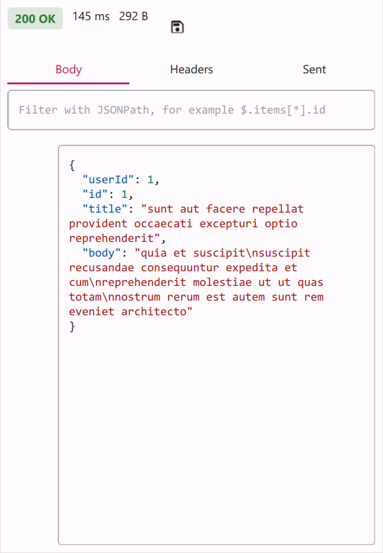
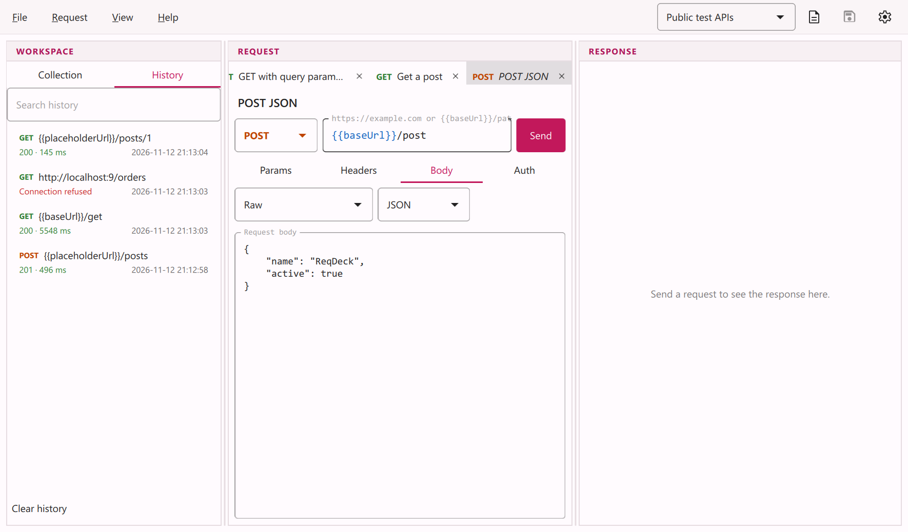

# Responses

## Status

The first number tells whether the request worked. Codes starting with 2 mean success,
with 4 a problem with the request, with 5 a problem on the server.

| Status | Meaning |
|---|---|
| 200 OK | It worked. |
| 201 Created | Something new was created. |
| 204 No Content | It worked; there is nothing to show. |
| 400 Bad Request | The server did not understand the request. Check the body and parameters. |
| 401 Unauthorized | You are not logged in, or the token expired. |
| 403 Forbidden | You are logged in but not allowed. |
| 404 Not Found | Nothing at this address. Check the URL. |
| 429 Too Many Requests | Slow down and try later. |
| 500 Internal Server Error | The server failed. Not your fault, usually. |

Beside the status, ReqDeck shows the time and the size of the answer.

## Body and headers

- **Body** shows the answer, **Pretty** formats JSON and XML with highlighting and line
  numbers; switch it off to see the text as received.
- **Headers** lists the headers of the answer.
- Very large answers are kept on disk instead of in memory, and only their start is
  shown.

## Finding text

**Ctrl+F** finds text in the answer and counts the matches; **F3** and **Shift+F3** move
between them.

## JSONPath filter

A long JSON answer? Type a JSONPath in the field above it, for example `$.items[*].id`,
and only those values are shown. A path that is not valid is explained below the field.
Clear the field to see everything again. No script is run.

## Sent tab

The **Sent** tab shows what really went to the server: the method, the address, the
headers, and the size of the body, one block for each redirect. Passwords, tokens, cookie
values, and API keys are masked, for example `Bearer ••••••`. The network layer adds a
few headers of its own, such as `Host` and `Accept-Encoding`, which are not listed.

## Saving the answer

The save button beside the size writes the answer to a file as received, unpacked when it
came compressed, also a very large one of which only the start is shown.

## Certificates

When a server's certificate is not trusted, as is common on test servers, the request
stops with a banner. For a server you know, press **Continue**: the request is sent once
more without the check, for that server and the errors it showed. The response then
carries a warning.

## History

Every request you send lands in **History**, on the left. Double-click an entry to make a
new request from it. The search field above it keeps the entries that contain every word
you type, for example `post orders`.

The history keeps the last 200 requests without their answers. Values of fields whose
names mark a credential are removed before saving; see
[Workspaces and Data](Workspaces-and-Data#history).
