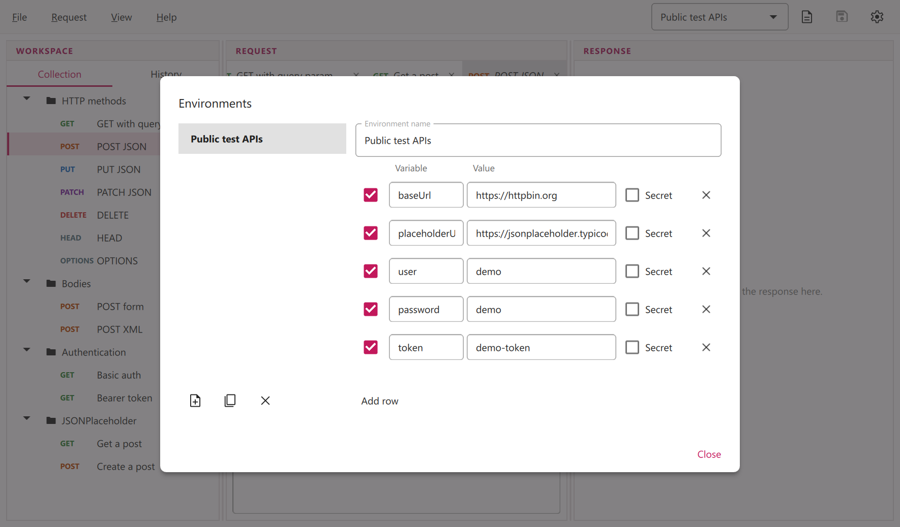

# Variables and Environments

## Variables

Write `{{name}}` anywhere a value goes:

- in the URL;
- in the Params, Headers, and form tables;
- in the auth fields;
- in the body.

ReqDeck replaces it with the value just before sending. The replacement is plain text
substitution; nothing is evaluated.

- After `{{` a list of known names appears. **Enter** or **Tab** inserts the selected one.
  In the body the list looks only at the current line.
- A name without a value is **underlined in red**, and a field that names an unknown
  variable gets a red frame.
- On **Send**, ReqDeck asks for every missing value in the *Values needed* dialog. A value
  entered there is used **once**; with *keep* checked it is saved as a secret variable.

## Environments

An environment is a named set of variables, for example *Local*, *Staging*, and
*Production*, each with its own `baseUrl` and `token`. The selector in the top bar picks
the active one; the environment editor creates, renames, and fills them.



### Secret variables

Mark a variable **Secret** for passwords, tokens, and keys:

- its value is masked in the editor;
- it is **not written to the `.reqdeck` file**; it is kept apart, encrypted for your
  Windows user account (see [Workspaces and Data](Workspaces-and-Data));
- on another computer the value is asked for again.

When you type a password or token straight into an auth field, ReqDeck shows a hint with
**Move to a secret**. One click creates a secret variable and puts `{{name}}` into the
field.

## Folder variables and order

A folder can hold variables too. A request sees the variables of every folder above it.
When the same name is defined in several places, the later source in this list wins:

1. folders, from the outermost to the innermost;
2. the active environment;
3. values entered in the *Values needed* dialog for this send.

## Chaining requests with `response()`

A value from the **last response** of another request can be put into this one:

```text
{{response("Login", "$.token")}}
{{response("Login", "header:Location")}}
```

- The first argument is the name (or id) of the other request.
- The second is a JSONPath into its JSON body, such as `$.token` or `$.items[0].id`, or
  `header:Name` for a response header.

Typical flow:

1. Send *Login* once.
2. In *Get profile*, set the header `Authorization` to `Bearer {{response("Login", "$.token")}}`.
3. Send *Get profile*; the token from the last *Login* answer is inserted.

Things to know:

- After `{{res` the completion offers `response("Name", "$")` for every request that has
  an answer.
- The answers are kept **in memory only** and never written to disk. After a restart,
  send the first request again.
- If several requests share a name, the one whose answer came last is used.
- Templates are not rewritten when a request is renamed: after a rename, use the new name.
- JSON bodies up to 4 MB are kept for this.
